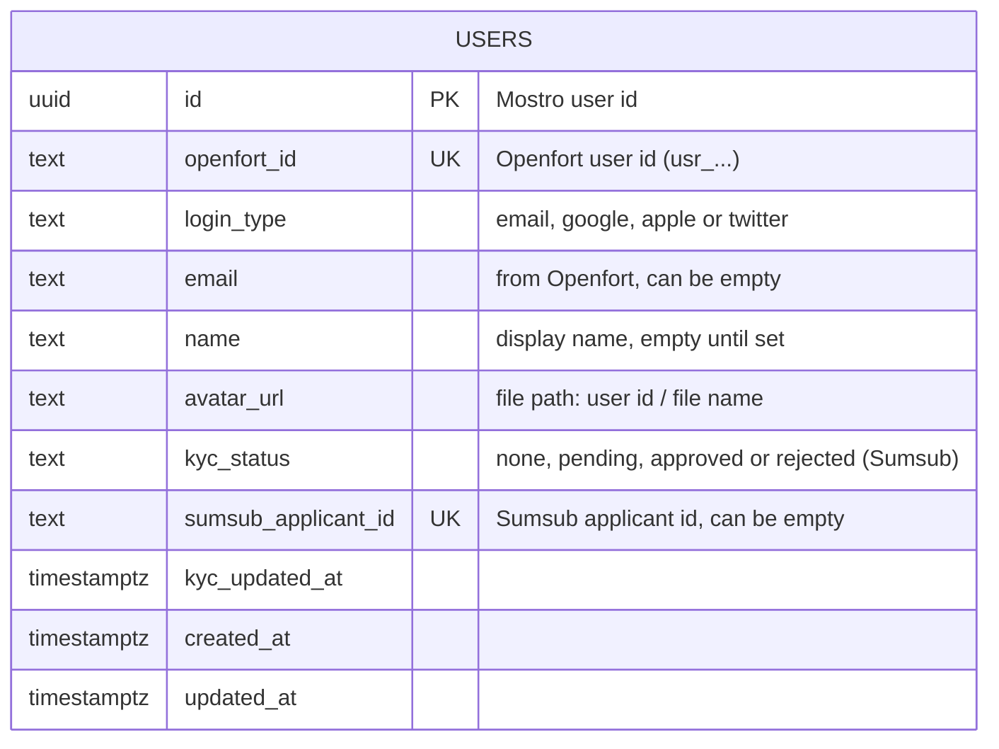

# Database schema

Mostro keeps one table. Everything about wallets and passes lives on the Solana blockchain, so it is not in the database.

## What each column is for

| Column        | Meaning                                                                                  |
| ------------- | ---------------------------------------------------------------------------------------- |
| `id`          | The Mostro user id (generated).                                                          |
| `openfort_id` | Who the person is in Openfort. Unique: the same person is never saved twice.             |
| `login_type`  | How they signed in: `email`, `google`, `apple` or `twitter`.                             |
| `email`       | Their email, when Openfort has one.                                                      |
| `name`        | The display name from the profile step. Empty until they choose one.                     |
| `avatar_url`  | Path of their picture: `<user id>/<file>`. The file sits on the server (`back/storage`). |
| `kyc_status`  | Result of the Sumsub check: `none` (default), `pending`, `approved` or `rejected`.        |
| `sumsub_applicant_id` | Sumsub applicant id. Unique. Documents stay at Sumsub.                            |
| `kyc_updated_at` | Last time the KYC status changed.                                                      |
| `created_at`  | When they first signed in.                                                               |
| `updated_at`  | Last change to the row.                                                                  |

## Not stored here

- **Wallet and pass ownership:** on the blockchain.
- **Passwords and login secrets:** handled by Openfort.
- **Card payments:** kept by MoonPay. The app only gets a "completed" signal.

## How to view or change it

- **Diagram:** paste [`schema.dbml`](schema.dbml) into https://dbdiagram.io (Import, DBML). You can drag, add tables and export an image or PDF.
- **In the repo:** the diagram above renders by itself on GitLab and GitHub.
- **Real changes:** are SQL files in [`flyway/application/sql`](flyway/README.md). After a migration changes a table, update this file and `schema.dbml`.
